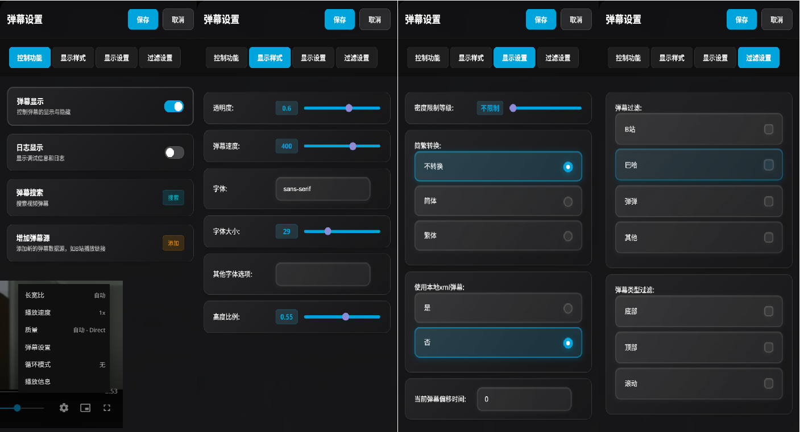

# jellyfin-danmaku

## Jellyfin弹幕插件

## 🛠️ 2.0 TypeScript 重构版

- 源码迁移到 `src/`（TypeScript + Svelte 5），通过 `bun run build:all` 构建
- 产物：`ede.user.js`（与旧地址兼容，可用于 Tampermonkey 和 `<script>` 引用）、`jellyfin-danmaku.user.js`（同上）、`ede.min.js`（仅用于 `<script>` 引用）
- 剧集匹配记录与偏移改存 IndexedDB，首次运行会自动迁移旧版 localStorage 数据与设置
- 发送弹幕功能已恢复：播放控制栏新增「发送弹幕」按钮，首次使用需登录弹弹Play

### 开发

```bash
bun install
bun run test        # 单元测试
bun run typecheck   # 类型检查
bun run check       # svelte-check
bun run lint
bun run build:all   # 输出到 dist/
```

## 🆕 v1.62.0 更新：弹幕屏蔽 / 相似弹幕合并 / 第三方 API 适配

> v1.62.0 整合了 [chen3861229/dd-danmaku](https://github.com/chen3861229/dd-danmaku) 与 [l429609201/dd-danmaku](https://github.com/l429609201/dd-danmaku)（Emby 版）的部分能力，并修复了一批 issue 中可复现的问题。2.0 重构版已包含以下全部功能与修复，v1.62 的设置（含屏蔽规则）升级后会自动迁移，ede.js 导出的设置备份也可以直接导入。

### 新增功能

- **弹幕屏蔽**（侧边栏新增「屏蔽」标签页）：关键词 / 正则 / 发送者 / 颜色四类规则，各自独立开关（2.0 中随「设置备份」一起导出、导入）
  - 关键词默认按「包含」匹配；需要正则时写成 `/正则/flags` 或 `re:正则`
- **相似弹幕合并**：同一时间窗内相似度超过阈值的弹幕合并为一条并标注 `[xN]`（默认关闭，阈值可调）
- **正文清理**：去掉第三方 API 拼在弹幕正文尾部的 B 站点赞数（如 `🤍 28`）
- **弹幕来源统计**：匹配信息中显示 `共 N 条（B站 x / 巴哈 y / 弹弹 z）`
- **第三方 API 一键配置**：填服务地址 + 客户端 Token 自动拼接 API 地址，支持 `/api/health` 探活与试搜
- **重新加载弹幕**：弹幕库里明明有数据却没显示时，一键重新拉取
- **时间轴微调**：快捷按钮微调，按当前集数记忆（2.0 为 ±0.1s / ±1s）
- **设置备份 / 恢复**：弹幕样式、过滤、屏蔽、API 等全部设置导出为 JSON
- **插件弹幕回退**：在线搜索无结果时，自动改用 `使用本地xml弹幕` 同一接口（jellyfin-plugin-danmu）的弹幕
- 内置 Danmaku 引擎 2.0.9 → 2.0.10，并加入运行时补丁：拖动进度条后弹幕立即恢复、倍速播放不再漂移
- 弹幕开关打开时补回正在飞行中的弹幕

### 修复

- 修复部分 issue：#24 #38 #72 #91 #94 #98
- 修复第三方弹幕 API 下「弹幕来源过滤」完全失效（来源标签大小写不匹配，如 `[bilibili]` / `[gamer]`）
- 修复等待播放器容器时的无限循环：容器未出现时会导致弹幕一直不显示，只能刷新页面
- 修复集号匹配错位：改为按每集标题中的集号精确匹配，兼容 `第4话` / `S02E04` / 纯数字标题
- 修复手动搜索关键词以 `@` 开头时命中服务端指令（如 misaka 的 `@QLHC`）的问题
- 修复「切换到其他弹幕 API 后旧的集数匹配缓存仍然生效」的问题

## 🎨 新版界面美化更新 (2025年8月)

**最新版本进行了全面的界面美化与功能优化：**

- **🎨 界面美化**：整体UI风格与配色已与Jellyfin默认主题保持一致
- **📱 一级界面简化**：播放界面仅保留弹幕开关按钮，界面更加简洁
- **⚙️ 设置界面重新设计**：其余弹幕设置功能移入 "设置" → "弹幕设置"
- **📋 侧边栏交互**：弹幕设置采用侧边栏弹出方式，操作更直观便捷

### 新设置界面截图



---


## 界面说明

> 请注意README上方截图可能与最新版存在差异，请以实际版本与说明为准

### 播放界面 (简化版)

播放界面左下方有**弹幕开关**和**发送弹幕**按钮：
- **弹幕开关**: 切换弹幕显示/隐藏状态
- **发送弹幕**: 登录弹弹Play后，在当前播放时间发送滚动/顶部/底部弹幕（匹配到弹弹Play剧集后可用）

### 弹幕设置 (侧边栏)

点击控制栏的**弹幕设置**按钮，或 "设置" → "弹幕设置" 打开。所有改动**即时生效并自动保存**，可边看边调；面板不遮挡画面，点击面板外或按 Esc 关闭。界面配色跟随 Jellyfin 12 当前主题（10.x 使用默认深色）。

- **当前视频**: 显示匹配到的番剧/剧集、弹幕条数与来源统计；手动匹配；重新加载；增加弹幕源（如B站播放链接，已登录时会提交给弹弹Play）；当前集时间偏移（±0.1s / ±1s 微调，后续未单独设置的集数会沿用）
- **显示**: 弹幕开关、不透明度、字号 [8, 80]、滚动速度 [20, 600]、显示区域 [0, 100%]、密度限制（不限制/宽松/适中/严格）*、防重叠、字体与字体选项，支持恢复默认
- **过滤**: 按来源（B站、巴哈姆特、弹弹Play、其他）和类型（滚动、顶部、底部）屏蔽，支持恢复默认
- **屏蔽**: 关键词 / 正则 / 发送者 / 颜色规则（各自独立开关），去掉点赞数，合并相似弹幕（阈值可调）
- **更多**: 弹弹Play 登录、简繁转换、优先使用本地 XML 弹幕、匹配失败时使用插件弹幕、自定义 CORS 代理与 API（可切换 [l429609201/misaka_danmu_server](https://github.com/l429609201/misaka_danmu_server)，API 填 `http://<服务器IP>:<端口>/api/v1/<你的Token>`，或用「御坂网络」填地址 + Token 一键配置并测试连接）、设置备份/恢复、调试日志

 **除0级外均带有每3秒6条的垂直方向弹幕密度限制,高于该限制密度的顶部/底部弹幕将会被转为普通弹幕*

## 支持的客户端

- Jellyfin Web
- Jellyfin Android (播放器类型仅限网页播放器)
- Jellyfin iOS

## 弹幕

弹幕来源为 [弹弹 play](https://www.dandanplay.com/) ,已开启弹幕聚合(Acfun/Bili/Tucao/Baha/5DM/iQIYI等不知名网站弹幕融合)

**在启用了`使用本地xml弹幕`后，会尝试调用[cxfksword/jellyfin-plugin-danmu](https://github.com/cxfksword/jellyfin-plugin-danmu)的API获取其预先下载好的xml弹幕，绕过弹弹play的弹幕查询和加载**

## 数据

匹配完成后对应关系会保存在**浏览器(或客户端)本地存储**中,后续播放(包括同季的其他集)会优先按照保存的匹配记录载入弹幕

## 安装

任选以下一种方式安装即可，**方式1-3可以持久化。**

**注：** 安装完首次使用时，确保只有当前一个客户端访问服务器，以方便根据当前用户id获取Session时能唯一定位到当前客户端设备id。（主要是由于非Jellyfin Web客户端没有默认在localstorage中存储DeviceID）

**由于Cloudflare Pages被干扰，推荐使用以下任一地址替代原本的** ~~https://jellyfin-danmaku.pages.dev/ede.user.js~~

> https://cdn.jsdelivr.net/gh/Izumiko/jellyfin-danmaku@gh-pages/ede.user.js   
> https://jellyfin-danmaku.930524.xyz/ede.user.js   
> https://jellyfin-danmaku.vercel.app/ede.user.js   


### 1. 浏览器插件 (推荐)

1. [安装Tampermonkey插件](https://www.tampermonkey.net/)

**注：** 首次安装完Tampermonkey插件后记得启动[开发者模式用于运行用户脚本](https://www.tampermonkey.net/faq.php#Q209)

2. [添加脚本](https://cdn.jsdelivr.net/gh/Izumiko/jellyfin-danmaku@gh-pages/ede.user.js)

### 2. 反向代理处理 (推荐)

#### 2.1 Nginx

使用Nginx反向代理`Jellyfin`并在`location`块中插入:

```conf
proxy_set_header Accept-Encoding "";
sub_filter '</body>' '<script src="https://cdn.jsdelivr.net/gh/Izumiko/jellyfin-danmaku@gh-pages/ede.user.js" defer></script></body>';
sub_filter_once on;
```

- [`完整示例`](https://github.com/Izumiko/jellyfin-danmaku/issues/8)

#### 2.2 Caddy (`caddy2-filter` 插件)

下载Caddy二进制文件时，增加第三方模块[`sjtug/caddy2-filter`](https://github.com/sjtug/caddy2-filter)，之后，在`Caddyfile`中按如下内容修改

```Caddyfile
# 全局设置
{
    order filter after encode
}

# 网站设置
example.com {
    filter {
        path /web/.*
        search_pattern </body>
        replacement "<script src=\"https://cdn.jsdelivr.net/gh/Izumiko/jellyfin-danmaku@gh-pages/ede.user.js\" defer></script></body>"
        content_type text/html
    }
    reverse_proxy localhost:8096 {
        header_up Accept-Encoding identity
    }
}
```

#### 2.3 Caddy (`replace_response` 插件)

下载Caddy二进制文件时，增加模块[`caddyserver/replace-response`](https://github.com/caddyserver/replace-response)，之后，在`Caddyfile`中按如下内容修改

```Caddyfile
# 网站设置
example.com {
    replace /web/* {
        match {
            header Content-Type text/html*
        }
        "</body>" "<script src=\"https://cdn.jsdelivr.net/gh/Izumiko/jellyfin-danmaku@gh-pages/ede.user.js\" defer></script></body>"
    }
    reverse_proxy localhost:8096 {
        header_up Accept-Encoding identity
    }
}
```

### 3. 修改服务端启动命令

[思路来源](https://github.com/Izumiko/jellyfin-danmaku/issues/20)

**注**：修改镜像需要root权限，请勿更改容器的运行用户

#### 3.1 Docker模式启动的服务端

官方镜像的Entrypoint是`/jellyfin/jellyfin`，`hotio/jellyfin`镜像的Entrypoint是`/init`，可在`docker-compose.yml`的jellyfin部分增加一行如下代码，用带sed的Entrypoint替换默认的Entrypoint。

官方镜像：

```yaml
entrypoint: sh -c "sed -i 's#</div></body>#</div><script src=\"https://cdn.jsdelivr.net/gh/Izumiko/jellyfin-danmaku@gh-pages/ede.user.js\" defer></script></body>#' /jellyfin/jellyfin-web/index.html && exec /jellyfin/jellyfin"
```

`hotio/jellyfin`镜像：

```yaml
entrypoint: sh -c "sed -i 's#</div></body>#</div><script src=\"https://cdn.jsdelivr.net/gh/Izumiko/jellyfin-danmaku@gh-pages/ede.user.js\" defer></script></body>#' /usr/share/jellyfin/web/index.html && exec /init"
```

#### 3.2 直接用包管理器安装，并使用systemd管理的服务端

部分用户使用deb包或者Arch Linux的aur包安装Jellyfin，可以修改systemd service文件来实现启动时追加js脚本。
运行`systemctl edit jellyfin.service`，进入编辑界面，然后输入如下内容：

deb包安装的版本：

```ini
[Service]
ExecStartPre=-/usr/bin/sed -i 's#</div></body>#</div><script src="https://cdn.jsdelivr.net/gh/Izumiko/jellyfin-danmaku@gh-pages/ede.user.js" defer></script></body>#' /usr/share/jellyfin/web/index.html
```

aur安装的版本：

```ini
[Service]
ExecStartPre=-/usr/bin/sed -i 's#</div></body>#</div><script src="https://cdn.jsdelivr.net/gh/Izumiko/jellyfin-danmaku@gh-pages/ede.user.js" defer></script></body>#' /usr/lib/jellyfin/jellyfin-web/index.html
```

保存后，运行`systemctl daemon-reload`生效，`systemctl restart jellyfin`重启当前服务。

### 4. 修改服务端

**可使用[@yomunsam](https://github.com/yomunsam)提供的自动化修改插件[yomunsam/Jellyfin.WebDanmakuStarter](https://github.com/yomunsam/Jellyfin.WebDanmakuStarter)，或者按照下面的方法手动修改。**

修改文件 `/usr/share/jellyfin/web/index.html`
*(Default)*

或 `/jellyfin/jellyfin-web/index.html`
*(Official Docker)*

**在`</body>`前添加如下标签**

```html
<script src="https://cdn.jsdelivr.net/gh/Izumiko/jellyfin-danmaku@gh-pages/ede.user.js" defer></script>
```

**Shell中的操作命令为：**

*Official Docker:*

```bash
sed -i 's#</body>#<script src="https://cdn.jsdelivr.net/gh/Izumiko/jellyfin-danmaku@gh-pages/ede.user.js" defer></script></body>#' /jellyfin/jellyfin-web/index.html
```

*Default:*

```bash
sed -i 's#</body>#<script src="https://cdn.jsdelivr.net/gh/Izumiko/jellyfin-danmaku@gh-pages/ede.user.js" defer></script></body>#' /usr/share/jellyfin/web/index.html
```

该方式安装与浏览器插件安装**可同时使用不冲突**

## 常见弹幕加载错误/失败原因

1. 译名导致的异常: 如『よふかしのうた』 Emby 识别为《彻夜之歌》后因为弹弹 play 中为《夜曲》导致无法匹配
2. 存在多季/剧场版/OVA 等导致的异常: 如『OVERLORD』第四季若使用S[N]格式归档(如OVERLORD/S4E1.mkv或OVERLORD/S4/E1.mkv),可能出现匹配失败/错误等现象
3. 其他加载BUG: ~~鉴定为后端程序猿不会前端还要硬写JS~~,有BUG麻烦 [开个issue](https://github.com/Izumiko/jellyfin-danmaku/issues/new/choose) THX
4. 使用l429609201/misaka_danmu_server且通过https访问Jellyfin时，需要反代misaka_danmu_server并自行处理CORS问题。

> 首次播放时请检查当前弹幕信息是否正确匹配,若匹配错误请尝试手动匹配


[](https://starchart.cc/Izumiko/jellyfin-danmaku)
